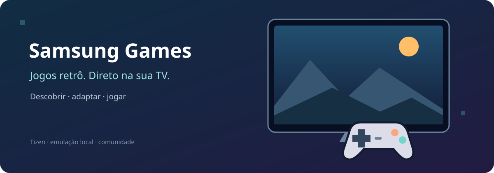
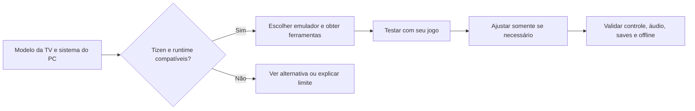

<div align="center">



# Seu videogame retrô pode estar na sua TV

**Um ponto de partida para instalar e ajustar emuladores em TVs Samsung com Tizen.**

[Quero usar uma IA](prompts/INSTALAR-NA-MINHA-TV.md) · [Quero fazer por conta própria](docs/INSTALACAO.md) · [Quero ver os testes](docs/RESULTADOS.md)

</div>

A ideia começou com uma pergunta: dá para jogar Super Nintendo na TV sem deixar o computador ligado? Na nossa Samsung Q60C, deu. Empacotamos o emulador com os arquivos locais, ajustamos o uso de memória e colocamos um jogo para rodar com imagem e som.

Agora queremos encurtar esse caminho para quem chegar aqui com **outra TV, outro jogo ou outro emulador**. Este repositório reúne o que funcionou, scripts para reproduzir o teste e um prompt que ajuda uma IA a adaptar o processo ao seu aparelho. Você não precisa ter nossos arquivos pessoais, Obsidian, root ou ferramentas previamente instaladas para começar.

> **A proposta é atender TVs Samsung com Tizen; a compatibilidade precisa ser conferida em cada aparelho.** O teste físico registrado é de uma QN50Q60C com Tizen 9. TVs antigas, inclusive Samsung anteriores ao Tizen, podem precisar de outro caminho ou não suportar este runtime.

## Escolha como começar

### “Quero colar um prompt e deixar a IA me ajudar”

Abra o **[prompt pronto para copiar](prompts/INSTALAR-NA-MINHA-TV.md)**. Ele já contém o endereço deste repositório, as fontes das ferramentas e um fluxo de decisão. A IA começa pelo modelo da sua TV e pelo sistema do seu computador, obtém o que falta e só então propõe a instalação.

Ela pode precisar de você para ativar o modo de desenvolvedor, entrar na sua conta Samsung, conectar um controle ou confirmar o que aparece na tela. O prompt não depende de notas pessoais e não manda fazer root na TV.

### “Quero entender e montar eu mesmo”

Siga o **[guia de instalação](docs/INSTALACAO.md)**. Ele começa do zero: onde baixar as ferramentas, como escolher entre o app original e o pacote local, como assinar e instalar e como desfazer.



## Não fica preso ao Mario — nem ao SNES

SMW PT-BR foi o jogo usado para a primeira prova. Você pode usar outra ROM de SNES no empacotador, sem tradução obrigatória. E o projeto não se resume ao RetroArch: o objetivo é ajudar a escolher e adaptar emuladores que façam sentido para cada TV.

O [RetroArch Tizen original](https://github.com/Sype0/retroarch-tizen) já apresenta cores para NES, SNES, Game Boy, Mega Drive, PlayStation e outros sistemas. Isso amplia as possibilidades, mas não significa que todos rodem bem em qualquer TV. Cada core tem requisitos e desempenho próprios; jogos 3D e ROMs grandes exigem atenção especial.

**O script deste repositório empacota atualmente SNES**, com três opções de core. Outros sistemas podem ser explorados pelo app original ou por uma adaptação do código. Outros emuladores independentes precisam de avaliação de compatibilidade; não foram testados aqui. Streaming, como Moonlight, também é uma opção de uso, mas exige outra máquina executando o jogo.

## O ajuste que fez diferença

Só baixar a resolução não resolveu nosso limite: os cores testados mostravam cerca de 39–42 FPS no contador. Com Snes9x 2010, reduzimos a **memória WASM inicial de 128 para 32 MiB**, mantendo crescimento automático. O heap cresceu para aproximadamente 38,4 MiB, e uma captura do mesmo jogo marcou **60,05 FPS**.

Não é um “modo turbo” universal. É um ajuste pequeno no empacotamento que valeu medir naquela TV. O script oferece `--initial-memory 128` para comparar com o valor original e recusa o patch se o layout esperado mudar. Mantivemos as [medições e suas limitações](docs/RESULTADOS.md) para quem quiser avaliar a escolha.

| O que conseguimos verificar | O que ainda falta |
|---|---|
| Imagem e áudio confirmados na Q60C | Controle físico e mapeamento dos botões |
| Carregamento com a rede do app bloqueada | Reinício físico da TV e sessão prolongada |
| SRAM e savestate persistentes após reabertura | Outros modelos, jogos e sistemas |

## Um exemplo com o seu jogo

Depois de instalar [Git](https://git-scm.com/downloads) e [Python 3](https://www.python.org/downloads/):

```bash
git clone https://github.com/leandroxse/samsung-games.git
cd samsung-games
python3 tools/build-smw.py --rom "/caminho/Meu jogo.sfc" --name "Meu jogo" --unsigned
```

No Windows, use `py -3` se o comando `python3` não existir. O script baixa o WGT base e os recursos públicos ausentes. A saída fica em `artifacts/SuperNintendo-SMW-PTBR.wgt` por compatibilidade com o primeiro teste; você pode escolher outro caminho com `--output`.

**Esse comando gera um pacote sem assinatura.** Ainda é preciso assinar com um certificado aceito pela sua TV e instalar. O [guia completo](docs/INSTALACAO.md) explica de onde vêm essas ferramentas. Nenhuma TV é acessada pelo script de build.

## O que você encontra aqui

| Arquivo | Uso |
|---|---|
| [Prompt para IA](prompts/INSTALAR-NA-MINHA-TV.md) | Começar sem conhecer a nossa instalação |
| [Guia de instalação](docs/INSTALACAO.md) | Preparar ferramentas, empacotar, assinar e instalar |
| [Resultados](docs/RESULTADOS.md) | Consultar hardware, escolhas, medições e pendências |
| [Empacotador Python](tools/build-smw.py) | Escolher ROM, título, core e memória inicial |
| [Preparador de tradução](tools/prepare-rom.sh) | Aplicar o BPS de SMW, caso você queira reproduzir esse exemplo |

## Créditos e uso das imagens

Este trabalho se apoia em [RetroArch Tizen, de Sype0](https://github.com/Sype0/retroarch-tizen), [RetroArch/libretro](https://github.com/libretro/RetroArch) e [Snes9x 2010](https://github.com/libretro/snes9x2010). Consulte e preserve as licenças de cada componente antes de redistribuí-lo. A tradução usada no teste foi SMW PT-BR 2.0, atribuída a BMatSantos no material fornecido pelo usuário.

A ilustração do topo foi criada para este repositório: não usa personagens, capturas de jogos nem logotipos oficiais. **Somente essa ilustração, `assets/retro-tv.svg`, é disponibilizada sob [CC0 1.0](https://creativecommons.org/publicdomain/zero/1.0/)**. Não há afiliação com Samsung, Nintendo ou o time libretro.

ROMs, BIOS, certificados, saves e pacotes com jogos ficam fora do Git. Use arquivos que você tem direito de usar.

<sub>Para encontrar este projeto: Samsung Smart TV emulator · emulador para Samsung Tizen · RetroArch Tizen · SNES · NES · Mega Drive · libretro · WebAssembly · WGT · jogos retrô sem PC.</sub>
