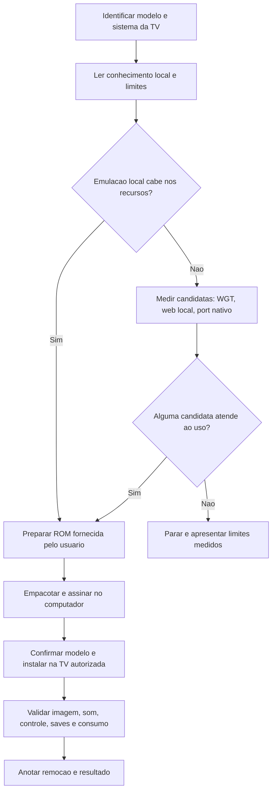

<div align="center">

# Super Nintendo na TV Samsung

**Emulação local de Super Nintendo em uma Samsung QN50Q60C com Tizen 9.**

ROM fornecida pelo usuário · jogo sem PC ligado · pacote com recursos locais


[Começar pelo passo a passo](#reproduzir-o-projeto) · [Usar prompt de IA](prompts/INSTALAR-NA-MINHA-TV.md) · [Ver medições](docs/RESULTADOS.md)

</div>

---

Este repositório registra uma prova real na TV autorizada: **Super Nintendo 0.3.4**, baseada no [RetroArch Tizen](https://github.com/Sype0/retroarch-tizen), com core Snes9x 2010 e SMW PT-BR 2.0. A ROM foi fornecida pelo usuário. A imagem e o som foram confirmados na TV; o teste chegou a 60,05 FPS num trecho curto.

O pacote carrega jogo, core e recursos da própria TV. Depois da instalação, não precisa de PC nem de servidor web durante o jogo. O projeto ainda é um protótipo: controle físico, reinício da TV, sessões longas e outros jogos precisam de validação.

> **Atalho:** quer que uma IA conduza a instalação na sua TV? Abra [`prompts/INSTALAR-NA-MINHA-TV.md`](prompts/INSTALAR-NA-MINHA-TV.md), copie o prompt inteiro e cole na IA que tem acesso ao seu computador. O fluxo manda identificar sua TV, ler suas notas locais, comparar opções, medir e instalar com reversão anotada.

## Escolha do caminho



## O que está aqui

| Caminho | Para que serve |
|---|---|
| [`tools/prepare-rom.sh`](tools/prepare-rom.sh) | Aplica um patch BPS a uma ROM original que você já possui. |
| [`tools/build-smw.py`](tools/build-smw.py) | Monta e assina o WGT com core, recursos e ROM locais. |
| [`prompts/INSTALAR-NA-MINHA-TV.md`](prompts/INSTALAR-NA-MINHA-TV.md) | Prompt pronto para outra IA conduzir descoberta, medição e instalação. |
| [`docs/RESULTADOS.md`](docs/RESULTADOS.md) | Hardware, candidatas, medições, validações e limites conhecidos. |
| [`docs/INSTALACAO.md`](docs/INSTALACAO.md) | Preparação, montagem, instalação, validação e remoção. |

## Palavras-chave

Samsung Smart TV, Samsung Tizen, Tizen 9, Tizen TV emulator, emulador SNES para TV Samsung, Super Nintendo na TV, RetroArch Tizen, libretro WASM, WebAssembly emulator, Snes9x 2010, instalar WGT na Samsung TV, jogos retrô sem PC, QN50Q60CAGXZD, homebrew Tizen.

ROMs, patches, WGTs, executáveis, certificados e capturas de teste ficam fora do Git. O `.gitignore` protege esses arquivos locais.

## Reproduzir o projeto

### 1. Confira o ambiente

Esta versão foi medida na **QN50Q60CAGXZD**, plataforma `23_NKL_UHD_T09`, Tizen 9, firmware `T-NKLCUABC-0090-2220.4`. Outras TVs podem ter recursos, sistema, resolução e instalação diferentes. Primeiro confirme o modelo; não opere uma TV de outra pessoa.

No computador, este projeto usa Python 3, Floating IPS (`flips`), o WGT de base e um perfil de assinatura Tizen já configurado. A montagem baixa os recursos públicos do RetroArch Tizen se eles ainda não existirem no cache local.

### 2. Obtenha os arquivos de entrada

Crie as pastas locais. Baixe o WGT de base da release v0.3.2 do projeto original e use somente jogos e patches que você tem direito de usar:

```bash
mkdir -p artifacts .work
curl -fL \
  https://github.com/Sype0/retroarch-tizen/releases/download/v0.3.2/RetroArch.wgt \
  -o artifacts/RetroArch-v0.3.2.wgt
```

Coloque sua ROM original e patch BPS nos caminhos que serão passados ao preparador. O projeto não fornece nem baixa ROM ou BIOS.

### 3. Prepare a ROM traduzida

Instale ou compile Floating IPS v198 para seu computador e deixe `flips` disponível no `PATH`. Depois aplique o patch:

```bash
tools/prepare-rom.sh \
  "/caminho/para/Super Mario World (USA).sfc" \
  "/caminho/para/SMW-PTBR-2.0.bps"
```

O script grava `roms/SMW-PTBR-2.0.sfc`. Floating IPS confere se a ROM de entrada corresponde ao patch. Se a conferência falhar, pare e confira os arquivos; não force o patch.

### 4. Monte e assine o aplicativo

Informe o caminho do utilitário `tizen-sdb` e da pasta do seu perfil privado de assinatura. A pasta deve conter `author.p12`, `distributor.p12` e `password.txt`. O script lê a senha sem imprimi-la:

```bash
export TIZEN_SDB="$HOME/TizenTube/tools/tizen-sdb"
export TIZEN_CERT_DIR="/caminho/para/seu/perfil-de-assinatura"
python3 tools/build-smw.py
```

O WGT final aparece em `artifacts/SuperNintendo-SMW-PTBR.wgt`. O script adapta o carregador, inclui só o core Snes9x 2010 e recursos necessários, reduz a memória WASM inicial de 128 para 32 MiB mantendo crescimento automático e assina o pacote. Veja [como o teste foi medido](docs/RESULTADOS.md#ajuste-de-memoria-e-desempenho).

### 5. Instale e valide na TV

Use o instalador Tizen já configurado para sua rede. Antes de instalar, redescubra o IP e confirme o modelo pela API da TV. Na Q60C testada, a instalação foi feita pelo SDB local da própria TV com apoio do Vetro existente; isso evitou alterar IP, rotas ou firewall do computador.

Confirme que o app aparece em primeiro plano. Abra SMW PT-BR e confira imagem, som, controle e salvamento. A instalação foi testada offline após o carregamento do app; Wi-Fi da TV não foi desligado.

O roteiro específico, a reversão e a proteção de saves estão em [`docs/INSTALACAO.md`](docs/INSTALACAO.md). Anote sempre o ID do pacote e o comando de remoção antes de instalar.

## Créditos e licenças

- [RetroArch Tizen](https://github.com/Sype0/retroarch-tizen): interface e integração Tizen; consulte a licença do projeto original.
- [RetroArch / libretro](https://github.com/libretro/RetroArch) e [Snes9x 2010](https://github.com/libretro/snes9x2010): frontend e core; preserve as licenças e avisos próprios ao redistribuir binários.
- Floating IPS v198: aplicação local de patch BPS.
- SMW PT-BR 2.0: patch de tradução BPS fornecido pelo usuário, atribuído no material de origem a BMatSantos.

Este repositório não redistribui jogo, BIOS, WGT assinado, executáveis nem certificados. Consulte as licenças originais antes de redistribuir componentes de terceiros.
